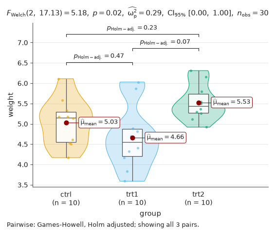
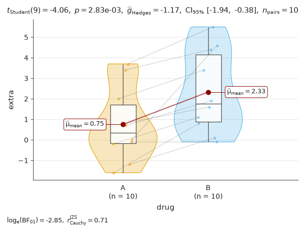
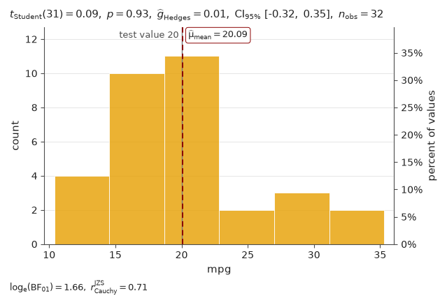
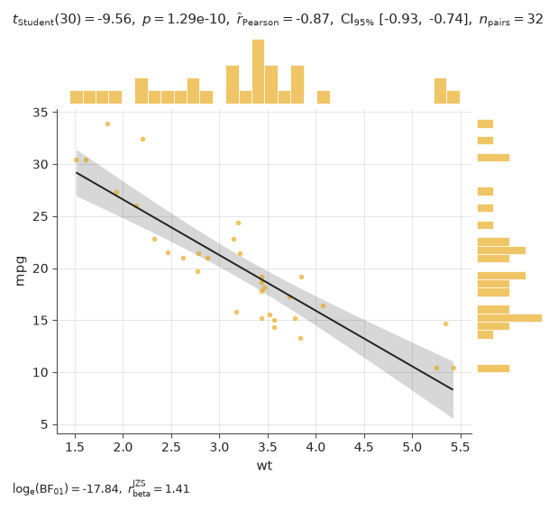
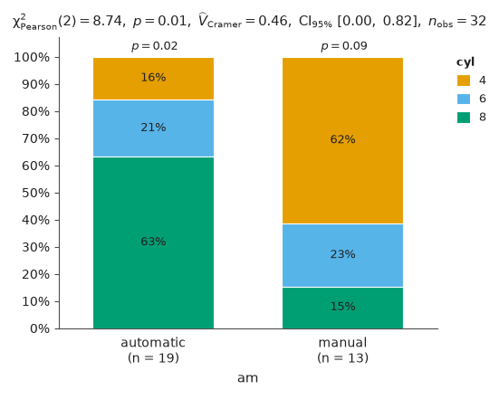

# inferplot

inferplot draws a statistical plot, runs the test that fits the design, and writes the
full result on the figure: statistic, degrees of freedom, exact p-value, effect size
with its confidence interval, Bayes factor, n and adjusted pairwise comparisons. It is
the Python counterpart of R's [ggstatsplot](https://github.com/IndrajeetPatil/ggstatsplot)
1.1.4, tested against its output, and written for AI coding agents and the
researchers who check their work.

**Status:** not released. inferplot is not on PyPI yet; install it from the
repository as below. Version 0.1 covers five functions; see
[what is not in v0.1](#not-in-v01).

## Install

Python 3.11 or newer. Straight from GitHub (this needs git):

```sh
pip install "inferplot[pandas] @ git+https://github.com/sinkomr/inferplot"
```

Or from a clone of the repository:

```sh
git clone https://github.com/sinkomr/inferplot
cd inferplot
pip install ".[pandas]"
```

With uv, put `uv` in front of `pip install` in either form. The extras `pandas`,
`polars` and `pyarrow` install the data frame library you use; inferplot itself needs
only numpy, scipy, matplotlib and narwhals. To check the installation, run the quick
start below: it should print the three lines shown under it.

<!-- PyPI: once 0.1.0 is published, this section gets `pip install "inferplot[pandas]"`. -->

## Quick start

```python
import pandas as pd

import inferplot as ip

# PlantGrowth (R's datasets): dried weight of plants, a control and two treatments.
weights = {
    "ctrl": [4.17, 5.58, 5.18, 6.11, 4.50, 4.61, 5.17, 4.53, 5.33, 5.14],
    "trt1": [4.81, 4.17, 4.41, 3.59, 5.87, 3.83, 6.03, 4.89, 4.32, 4.69],
    "trt2": [6.31, 5.12, 5.54, 5.50, 5.37, 5.29, 4.92, 6.15, 5.80, 5.26],
}
df = pd.DataFrame(
    [(group, w) for group, ws in weights.items() for w in ws],
    columns=["group", "weight"],
)

# 1. One call with the design stated: independent groups, means compared.
fig = ip.betweenstats(df, "group", "weight", type="parametric")

# 2. Read the result as text, not from the image.
print(fig.result.text.apa)

# 3. Check for problems; act on each issue or report it, and report the notes.
for issue in fig.check():
    print(issue)
for note in fig.result.warnings:
    print("note:", note)

# 4. Save with fig.save(): text stays editable and the result is embedded.
fig.save("weight.svg")
```

It prints:

```text
Welch's ANOVA: F(2, 17.13) = 5.18, p = .017, partial omega squared = .29, 95% CI [.00, 1.00], n = 30.
[info] pairs_hidden: 3 of 3 pairwise comparisons are not drawn (pairwise_display='significant'); all of them are in result.pairwise. Pass pairwise_display='all' to draw every pair.
note: The Bayes factor caption for three or more groups arrives in inferplot 0.2.
```

`fig.result.to_json()` holds every number and text on the figure, and
`fig.result.to_frame()` gives one row per test. Save with `fig.save()`, not with
pyplot: the figure is not pyplot's current figure, so `plt.savefig()` writes
pyplot's own, empty figure, and `fig.figure.savefig()` writes the text as outlines and leaves the
result out of the file. To look at a figure, save it and open the file; in a
Jupyter notebook, end the cell with `fig` and it is shown inline. There is no
window and no `fig.show()`: inferplot draws without a display.

## One figure per function

Each figure comes from the script beside it in [docs/examples](docs/examples).
`uv run python docs/examples/readme_images.py` regenerates them; the files are
identical byte for byte on the same platform and package versions.

| Function | Example |
| --- | --- |
| `betweenstats`: independent groups ([script](docs/examples/betweenstats.py)) |  |
| `withinstats`: the same subjects measured repeatedly ([script](docs/examples/withinstats.py)) |  |
| `histostats`: one sample against a value ([script](docs/examples/histostats.py)) |  |
| `scatterstats`: two measurements ([script](docs/examples/scatterstats.py)) |  |
| `barstats`: counts of categories ([script](docs/examples/barstats.py)) |  |

## Which function for which question

| Question | Call |
| --- | --- |
| Do independent groups differ? | `ip.betweenstats(df, "group", "score")` |
| Do repeated measurements of the same subjects differ? | `ip.withinstats(df, "time", "score", subject_id="subject")` |
| Does one sample differ from a fixed value? | `ip.histostats(df, "score", test_value=100)` |
| Are two measurements related? | `ip.scatterstats(df, "height", "weight")` |
| Do the shares of categories differ between groups? | `ip.barstats(df, "answer", "group")` |
| Do the shares of categories differ from expected shares? | `ip.barstats(df, "answer", ratio=[0.5, 0.25, 0.25])` |
| Did the same units change category between two measurements? | `ip.barstats(df, "before", "after", paired=True)` |

Data are a pandas, polars or pyarrow data frame in long format: one row per
observation, with repeated measurements as several rows of the same subject.
Missing values are dropped and counted (`fig.result.n_dropped`).

### Choosing `type`

`type` picks the family of methods. Choose it from the kind of data and the
research question before you look at any result. Do not run several types and
report the one that gives a small p-value: that makes false positives far more
likely. If several analyses were run, report all of them.

- `"parametric"` (the default) compares means (Welch's t-test and ANOVA, the paired
  t-test, Pearson's r) with Hedges' g or omega squared. Pick it for measurements
  whose distributions within groups are not strongly skewed and have no extreme
  outliers, or for large samples. Welch's tests do not assume equal variances.
- `"nonparametric"` uses ranks (Mann-Whitney, Kruskal-Wallis, signed-rank, Friedman,
  Spearman's rho) and shows medians. Pick it for ratings and other ordinal data, or
  for strongly skewed measurements. It asks whether values in one group tend to be
  larger, not whether the means differ.
- `"robust"` uses 20% trimmed means (`tr=`) and winsorized correlations, with
  bootstrap intervals. Pick it for roughly symmetric data with heavy tails or
  outliers that are real observations and cannot be removed.
- `"bayes"` reports a Bayes factor, BF10, how many times more likely the data are if
  there is an effect than if there is none, with a Cauchy prior of scale
  `bf_prior=0.707` (a stretched beta prior for correlations). Pick it when evidence for "no difference" matters as much as
  evidence for a difference. In v0.1 it covers two groups or conditions, one sample
  and correlations.

`barstats` has one test per design; its `type` accepts `"parametric"` and
`"nonparametric"`, which run the same test.

## Differences from ggstatsplot

inferplot computes ggstatsplot 1.1.4's methods and prints its subtitles. It differs
on purpose in these ways:

- `withinstats` requires `subject_id`: measurements are paired by subject, never by
  row order.
- Bootstrap intervals use 2,000 resamples drawn with `seed` (default 0) instead of
  100, so they differ from ggstatsplot's by random noise.
- Nothing is ignored silently. Unknown arguments raise an error, and so do settings
  that would change nothing or change what a number means (a `tr` with a type that
  trims nothing, a one-sided test with three groups). Arguments that have no effect
  on the given data add a note to `fig.result.warnings`. Where ggstatsplot drops
  its subtitle without a word (a table with one category, a ratio that does not sum
  to 1), inferplot raises an error that says why.
- When only the significant pairs are drawn, the caption says how many were tested.
- Where R's numerical routines are inaccurate, inferplot reports the accurate value:
  a few printed numbers differ, for example a Games-Howell p of 2.24e-14 where
  ggstatsplot prints 1.41e-09. Exactly collinear data give r = 1 or -1 and an infinite t.
  Counts that fit exactly print 0, not rounding noise such as 5.59e-09.
- Numbers are read as written: a value computed as 0.1 + 0.2 and a typed 0.3 are one
  value in the rank tests and the robust bootstraps (a tie, or a zero difference);
  R works on the two different binary numbers.
- In `barstats`, the exact tests between pairs of levels are held to about two
  seconds per table: a pair too large to compute is named, never approximated, and
  still counts in the adjustment for multiple comparisons. The pairs are listed in
  the order of the levels (ggstatsplot sorts them as text).
- The figures have their own look (Okabe-Ito colours) with ggstatsplot's layers and
  texts.

## Not in v0.1

Asking for these raises `NotImplementedError` with a message that says what to do
instead; where ggstatsplot would add them by default, inferplot leaves them out and
says so in `fig.result.warnings`. They are planned for v0.2.

- Bayes factors for three or more groups or conditions (a Bayesian ANOVA). There,
  `type="bayes"` needs `results_subtitle=False`, which draws a Bayes factor for
  every pair, and `bf_message=True` raises.
- Bayes factors for counts: `barstats(type="bayes")` or `bf_message=True`.
- Posterior estimates (the posterior difference or correlation with its credible
  interval) in Bayes subtitles.
- `grouping_var`, ggstatsplot's `grouped_*` functions: call the function once per
  subset of the data.
- Counterparts of `ggpiestats`, `ggdotplotstats`, `ggcorrmat` and `ggcoefstats`.

Robust pairwise comparisons in `betweenstats` also raise `NotImplementedError` when
a pair has fewer than 2 degrees of freedom, where ggstatsplot stops with an error
too. `barstats(type="robust")` raises `ValueError`: there is no robust test of
counts.

## Documentation

- [docs/api.md](docs/api.md): every function, argument, result field and check, in
  one file.
- [docs/intervals.md](docs/intervals.md): how far to trust each interval and test.
- [skills/inferplot/SKILL.md](skills/inferplot/SKILL.md): a Claude Code skill for
  projects that use inferplot. Copy the `skills/inferplot` folder into the
  project's `.claude/skills/` folder.
- [llms.txt](llms.txt): an index for language models.

## License and credits

MIT (see [LICENSE](LICENSE)). inferplot reproduces the statistical defaults, argument
names and texts of [ggstatsplot](https://github.com/IndrajeetPatil/ggstatsplot) and
adapts the text templates of
[statsExpressions](https://github.com/IndrajeetPatil/statsExpressions), both MIT,
by the ggstatsplot and statsExpressions authors. Several design ideas come from
[plotsalot](https://github.com/joshuamyers22/plotsalot), an earlier Python adaptation
of ggstatsplot. The datasets in the examples are from R's datasets package. The
notices are in [NOTICE](NOTICE).
